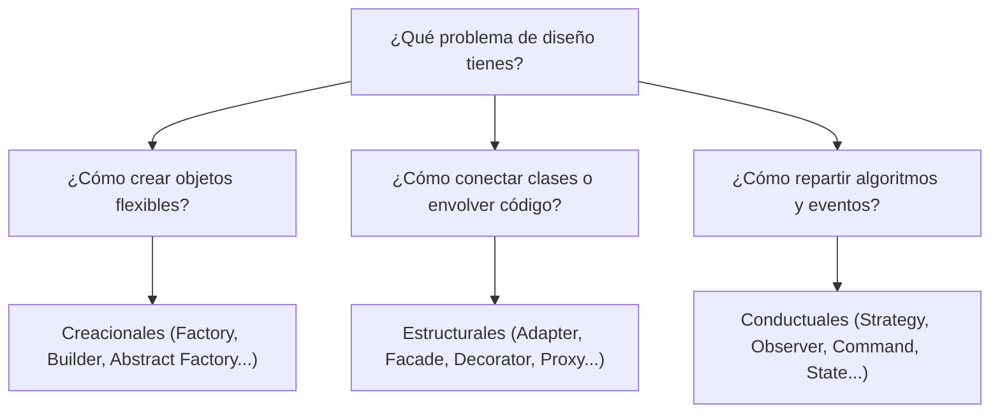

# Guía de Patrones de Diseño (`design-patterns`)

Esta *skill* proporciona el método de selección y justificación de patrones de diseño de software apoyándose en el [catálogo canónico](../../docs/patrones/diseno.md) y en [Refactoring Guru (en español)](https://refactoring.guru/es/design-patterns).

---

## 1. Puerta de decisión: ¿De verdad hace falta un patrón?

Antes de introducir un patrón, responde a estas dos preguntas:

1. **¿El problema existe hoy o es una conjetura futura?**
   - Si es para un requerimiento hipotético («por si algún día cambiamos de BD»), **no uses un patrón** (principio YAGNI: *You Aren't Gonna Need It*).
   - Usa una función simple o una clase directa hasta que la necesidad de variación sea real.
2. **¿El patrón reduce o multiplica la complejidad?**
   - Un patrón debe simplificar la evolución y el testeo del sistema. Si para una tarea de 20 líneas creas 5 interfaces y 3 factorías, es **sobreingeniería (*patternitis*)**.

---

## 2. Árbol de triaje rápido

Identifica qué familia de patrones resuelve el dolor arquitectónico:

### A. Dolor de Creación (Creacionales)
- Si el constructor tiene demasiados parámetros opcionales y es ilegible → [Builder](https://refactoring.guru/es/design-patterns/builder).
- Si no sabes en tiempo de compilación qué tipo exacto de objeto se va a instanciar → [Factory Method](https://refactoring.guru/es/design-patterns/factory-method).
- Si necesitas familias coherentes de productos intercambiables → [Abstract Factory](https://refactoring.guru/es/design-patterns/abstract-factory).

### B. Dolor de Composición y Estructura (Estructurales)
- Si una librería o servicio externo tiene una interfaz distinta a la que espera tu sistema → [Adapter](https://refactoring.guru/es/design-patterns/adapter).
- Si quieres añadir logging, caché o métricas a una clase sin modificarla ni heredar → [Decorator](https://refactoring.guru/es/design-patterns/decorator) o [Proxy](https://refactoring.guru/es/design-patterns/proxy).
- Si un subsistema complejo tiene 15 clases y quieres una única puerta de entrada sencilla → [Facade](https://refactoring.guru/es/design-patterns/facade).

### C. Dolor de Algoritmos y Colaboración (Conductuales)
- Si tienes un `switch` o `if/else` gigante que cambia la lógica de cálculo según el caso → [Strategy](https://refactoring.guru/es/design-patterns/strategy).
- Si múltiples componentes deben reaccionar cuando ocurre un cambio o evento → [Observer](https://refactoring.guru/es/design-patterns/observer).
- Si un objeto cambia drásticamente su comportamiento según su estado interno → [State](https://refactoring.guru/es/design-patterns/state).
- Si quieres desacoplar a quien emite una acción de quien la ejecuta (encolado, deshacer) → [Command](https://refactoring.guru/es/design-patterns/command).

---

## 3. Cómo citar y justificar el patrón en entregables

Cuando [`architect`](../../agents/architect.md) o [`implementer`](../../agents/implementer.md) propongan un patrón, deben incluir siempre:
1. **Nombre canónico con enlace a Refactoring Guru:** p. ej. [Strategy (Estrategia)](https://refactoring.guru/es/design-patterns/strategy).
2. **Problema concreto que resuelve:** por qué este patrón y no código directo.
3. **Compromiso (*trade-off*):** qué coste de abstracción se asume a cambio de qué flexibilidad.

Ejemplo en un [ADR](../../docs/glosario.md#adr):
> *«Se aplica el patrón [Strategy (Estrategia)](https://refactoring.guru/es/design-patterns/strategy) para desacoplar el motor de cálculo de tarifas. Permite añadir nuevas fórmulas de precios en clases separadas sin modificar el flujo de facturación, a cambio de introducir una interfaz adicional y clases individuales para cada tarifa.»*
