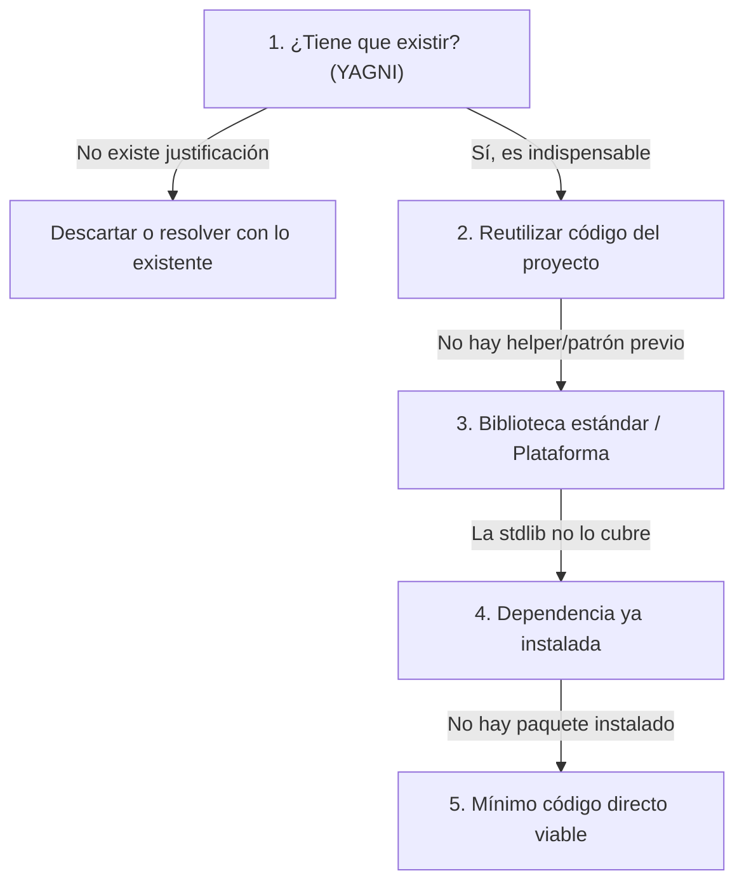

# Simplicidad Pragmática y Anti-Sobreingeniería (`ponytail`)

Inspirada en el principio del desarrollador senior pragmático: **«El mejor código es el que no hace falta escribir»**.
Esta *skill* provee el protocolo para resolver el problema completo con el menor volumen de código nuevo, previniendo la *patternitis* y la complejidad accidental.

---

## 1. Antes de escribir una sola línea (Mapeo de alcance)

Lee con atención la tarea y el código que va a tocar:
1. **Lista todos los puntos afectados:** llamadores directos e indirectos, tests existentes, fixtures, configuraciones, exportaciones e interfaces.
2. **Evalúa qué podría romperse:** datos expuestos o alterados, consumidores que queden desalineados.
3. **Fija el alcance:** el alcance es resolver la necesidad respetando lo que ya existe. Las funcionalidades extra no pedidas o las abstracciones especulativas **no son parte del alcance**.

---

## 2. La Escalera de Simplicidad (*Ladder of Laziness* / YAGNI)

Toma siempre la **primera opción viable** de la lista antes de pasar a la siguiente:



1. **¿Tiene que existir? (YAGNI estricto):**
   - Descarta opciones, configuraciones y flexibilidad que nadie ha solicitado.
   - Si una petición es vaga o amplia, construye la versión más concisa que resuelva el núcleo del problema.
2. **Reutiliza lo que ya hay en el repositorio:**
   - Si el proyecto ya tiene un helper, servicio, componente o convención para esto, úsalo tal como lo hace el código circundante.
3. **Biblioteca estándar y funciones nativas:**
   - Usa las capacidades del lenguaje y la plataforma antes de inventar utilidades o estructuras caseras.
4. **Dependencias ya instaladas:**
   - Si una librería del `package.json`, `pyproject.toml` o `requirements.txt` ya lo resuelve, úsala.
   - **Prohibido añadir una dependencia externa nueva** para resolver algo que se hace en pocas líneas con código estándar.
5. **Concisión y legibilidad:**
   - Si se resuelve limpiamente en una línea que cualquiera comprende de un vistazo, déjalo en una línea.
6. **Mínimo código viable:**
   - La menor diferencia (*diff*) funcionalmente completa gana. Una línea ilegible o críptica no es concisión.

---

## 3. Reglas innegociables: Lo que NUNCA se recorta

La simplicidad no es descuido. Hay aspectos que **nunca se omiten ni se simplifican a la baja**:
- **Validación en fronteras de confianza:** Entradas de usuario, APIs externas, deserialización y permisos.
- **Manejo de errores crítico:** Prevención de pérdida de datos, transacciones y fallos silenciosos.
- **Seguridad:** Criptografía, sanitización contra inyecciones y control de acceso.
- **Accesibilidad y cumplimiento normativo.**
- **Criterios de aceptación pedidos:** Todo lo solicitado explícitamente debe cumplirse y verificarse.

---

## 4. Gestión de atajos y deuda declarada (`shortcut:`)

Si por pragmatismo tomas un atajo consciente con un límite técnico conocido, déjalo documentado en el código mediante un comentario con este formato exacto:
```
// shortcut: <límite exacto>, <cuándo o bajo qué condición actualizar>
# shortcut: <límite exacto>, <cuándo o bajo qué condición actualizar>
```
Así la deuda queda identificada y no se confunde con descuido.

---

## 5. Cierre obligatorio del entregable

Toda respuesta o entrega de implementación que aplique Ponytail concluye con estas dos líneas explícitas:
- **Omitido deliberadamente:** qué decisiones o complejidades se descartaron y por qué.
- **Riesgos o límites asumidos:** qué condiciones de borde o supuestos debe conocer el revisor.
